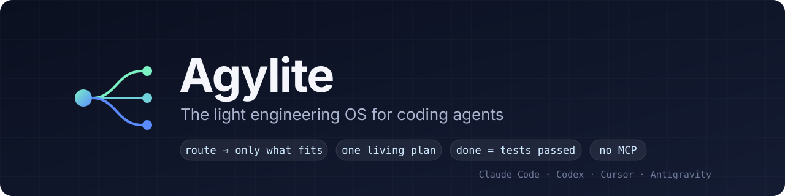
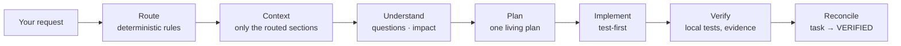

<p align="center">
  
</p>

<p align="center">
  <b>Route every request to the few skills it needs. Keep one living plan. Call it done only when the tests pass.</b>
</p>

<p align="center">
  <a href="https://github.com/Vikhyath-thelazycoder/AgyLite/releases"></a>
  <a href="https://github.com/Vikhyath-thelazycoder/AgyLite/actions/workflows/ci.yml"></a>
  <a href="LICENSE"></a>
  
  
  
</p>

<p align="center">
  <a href="#quick-start">Quick start</a> ·
  <a href="#why-agylite">Why</a> ·
  <a href="#how-it-works">How it works</a> ·
  <a href="#whats-inside">What's inside</a> ·
  <a href="#commands">Commands</a> ·
  <a href="#faq">FAQ</a> ·
  <a href="docs/architecture/TARGET_ARCHITECTURE.md">Docs</a>
</p>

---

Agylite is a local engineering OS for coding agents. It bundles the best parts of 15 open-source agent projects (ECC,
gstack, Graphify, UI/UX Pro Max, Open Design, Karpathy Skills and more) into **one plugin and one CLI**. Each request
loads only the few capabilities it needs, the agent follows one planned lifecycle, and work counts as done only when
local tests, types and builds pass and the evidence is recorded.

## Quick start

**1. Add the plugin** (in Claude Code)

```text
/plugin marketplace add Vikhyath-thelazycoder/AgyLite
/plugin install agylite@agylite-marketplace
```

**2. Install the engine** (once, in a terminal)

```bash
curl -fsSL https://raw.githubusercontent.com/Vikhyath-thelazycoder/AgyLite/main/install.sh | bash
```

This needs macOS or Linux, `git` and Python 3.10 or newer (on macOS: `brew install python@3.12`). It downloads the 15
pinned upstream projects once (about 2 minutes), builds the capability bundle in `~/.agylite`, and puts `agylite` on
your PATH. After that Agylite works offline. You never clone the upstream projects yourself.

**Optional: turn on auto-update.** In Claude Code run `/plugin`, open **Marketplaces → agylite-marketplace** and enable
auto-update (or add `"autoUpdate": true` to its entry under `extraKnownMarketplaces` in `~/.claude/settings.json`).
Claude Code then updates the plugin by itself, and the plugin brings the engine in `~/.agylite` up to the same version
in the background at the next session start.

**3. Start a new session and work as usual.** Ask for something like *"Build a small Python CLI todo app with tests"*:
the agent routes the request, writes a plan task, implements it test-first and verifies it before calling it done.
Run `agylite doctor` at any time to check the install.

<details>
<summary>Other hosts</summary>

| Host | Add Agylite |
|---|---|
| Codex | `codex plugin marketplace add Vikhyath-thelazycoder/AgyLite` then `codex plugin add agylite@agylite-marketplace` |
| Cursor | `agylite adapters install --host cursor` |
| Antigravity | `agylite adapters install --host antigravity` |

`agylite adapters status` shows each host as `FILES_PRESENT`, `INSTALLED` or `RUNTIME_VERIFIED` (only after the host
has actually run Agylite).
</details>

## Why Agylite

Installing agent plugins one by one loads every plugin's descriptions on every turn and leaves the model to guess which
one applies. Agylite routes deterministically and loads sections on demand.

| | Upstream plugins installed directly | **Agylite** |
|---|---:|---:|
| Per-turn context | ~32,000 tokens with five plugins installed | **~900 tokens** (plus up to 800 per prompt for the injected route, D-048) |
| Per-task guidance | the whole skill files a task triggers | **about half** (51.6 % less in the published run) |
| Choosing what applies | the model picks among all descriptions | **rules: 26/26 scenarios correct, p95 0.46 ms** |
| "Done" means | the agent says so | **tests, types and build passed, evidence on file** |

Measured with `agylite benchmark --compare`; tokens are bytes ÷ 4 estimates. The published run had four plugins
installed, and 703,956 of its 1,027,007 OLD tokens were their per-turn descriptions; on a machine without them, the
26-scenario suite is 42 % smaller with Agylite. In 7 of the 26 scenarios Agylite loads more than the upstream skill
would (small tasks pay its fixed per-task overhead).

Agylite loads selected sections of at most two files per capability. Whether that keeps the upstream skills' quality
is measured by `agylite benchmark --quality` (see [docs/benchmarks/QUALITY.md](docs/benchmarks/QUALITY.md)).
[Full results](docs/benchmarks/RESULTS.md).

## How it works



- **Route.** `agylite route` matches the request against rules and capability tags. *"Fix the payment webhook
  security"* gets security, impact analysis and security tests; *"make a launch video"* gets the video workflow and
  nothing else.
- **Context.** `agylite context` loads short capability cards first and the relevant skill sections only when needed,
  within a token budget.
- **Plan.** Every project has one plan (`docs/IMPLEMENTATION_PLAN.md`). Blocking requirement questions must be
  answered before a task starts, and task status rolls up into its phase.
- **Verify.** `agylite verify` runs the tests, type checks, lint and build that the change reaches, and records
  machine-readable evidence. Browser and screenshot "verification" is turned off by policy.
- **Watch it.** `agylite dashboard --open` shows the Agent Office: one agent per capability, lighting up as it works.
- **See what was used.** Every answer ends with `agylite used`: the routed capabilities, the upstream projects whose
  guidance was loaded (ECC, gstack, UI/UX Pro Max, …) and the engines that ran.

## What's inside

63 capabilities in 7 domains, each with recorded provenance (upstream, commit, path, hash, license):

| Domain | Capabilities | Highlights |
|---|---:|---|
| Engineering | 17 | planning, architecture, implementation, debugging, security, performance, migration, release, review |
| Testing | 9 | test strategy, local verification, regression, security and accessibility testing, evidence |
| Codebase | 3 | repository understanding, code search, impact analysis (Graphify code graph) |
| Design | 10 | design direction, design systems, typography, motion, accessibility, UI/UX Pro Max engine |
| SEO | 16 | technical and on-page audits, AI-search readiness, research, reporting (BeyondSEO runtime) |
| Media | 4 | launch videos, demos, presentations, showcases (Brag) |
| Observability | 4 | events, sessions, token metrics, risk detection (Beacon rules) |

## Commands

```bash
agylite route "Fix the payment webhook security." --brief   # what this request needs
agylite context engineering/security testing/security        # load just that guidance
agylite codebase affected                                    # files and tests the current change reaches
agylite verify                                               # run the impacted checks, record evidence
agylite dashboard --open                                     # the Agent Office
agylite used                                                 # what this session used: capabilities, upstreams, engines
```

<details>
<summary>All commands</summary>

| Area | Commands |
|---|---|
| Routing and context | `route`, `context`, `bootstrap` |
| Project | `project init\|status\|questions\|answer`, `state`, `plan index\|show\|add-task\|set-status\|reconcile`, `decide` |
| Codebase | `codebase affected\|update\|query\|path\|explain` |
| Engineering | `gates` (acceptance gates) |
| Testing | `verify`, `test`, `verify exception --reason` |
| Design | `design search\|system\|check` |
| SEO | `seo run\|evidence\|authorize` |
| Media | `media plan\|music-cues` |
| Operations | `used`, `dashboard`, `events`, `runtime status\|install`, `update`, `rollback`, `gc`, `bundle`, `registry`, `adapters`, `doctor`, `validate`, `benchmark` |
</details>

## Staying current

Upstreams are pinned, never pulled blindly. `agylite update --check` lists new upstream commits, `agylite update
--latest` applies them through every check and switches only when all pass, and `agylite rollback` undoes it. A GitHub
Action checks daily and opens a weekly pull request with checked updates.

## Principles

- **Light.** A few short entry skills on every turn; everything else is routed and loaded in budgeted sections.
- **Deterministic.** Routing is rules, not a model call.
- **Local and test-first.** Done means recorded evidence from tests, types, lint and build.
- **Nothing always-on.** No daemons and no MCP servers; engines start per command in isolated environments.
- **Traceable.** Every bundled file records where it came from and under which license.

## Built on

Agylite stands on the work of these projects. Their content keeps its original license; see
[THIRD_PARTY_NOTICES.md](THIRD_PARTY_NOTICES.md).

| Project | Used for | License |
|---|---|---|
| [ECC](https://github.com/affaan-m/ECC) | engineering workflows, review, security | MIT |
| [Addy Osmani's agent skills](https://github.com/addyosmani/agent-skills) | production engineering practices | MIT |
| [gstack](https://github.com/garrytan/gstack) | review and release workflows | MIT |
| [Karpathy Skills](https://github.com/multica-ai/andrej-karpathy-skills) | coding principles | MIT |
| [Unlazy](https://github.com/Leonxlnx/unlazy) | completion gates | MIT |
| [Ponytail](https://github.com/DietrichGebert/ponytail) | simplicity reviews | MIT |
| [Graphify](https://github.com/Graphify-Labs/graphify) | code graph and impact analysis | Apache-2.0 |
| [UI/UX Pro Max](https://github.com/nextlevelbuilder/ui-ux-pro-max-skill) | design search engine and rules | MIT |
| [Open Design](https://github.com/nexu-io/open-design) | design systems and direction | Apache-2.0 |
| [Taste](https://github.com/Leonxlnx/taste-skill) | visual quality | MIT |
| [Appllama](https://github.com/Appllama/appllama-skills) | native mobile rules | MIT |
| [Agency Agents](https://github.com/msitarzewski/agency-agents) | specialist perspectives | MIT |
| [BeyondSEO](https://github.com/beyondtahir/beyondseo) | SEO crawler and audits | MIT |
| [Brag](https://github.com/latent-spaces/brag) | launch videos and showcases | MIT |
| [Agent Beacon](https://github.com/Asymptote-Labs/agent-beacon) | risk-detection rules | MIT |

## FAQ

<details>
<summary><b>Do I need to install ECC, UI/UX Pro Max or the other projects separately?</b></summary>

No. The installer fetches the parts Agylite uses at pinned commits and builds them into one local bundle. If you
already have some of them installed as separate plugins, `agylite doctor` shows how many tokens they add per turn, so
you can decide whether to remove them.
</details>

<details>
<summary><b>Is the plugin alone enough?</b></summary>

The plugin is the host integration; the engine is installed once with the one-line installer above. Without the engine,
the plugin tells you how to finish setup at session start instead of failing.
</details>

<details>
<summary><b>Does my code leave my machine?</b></summary>

No. Routing, context, planning, verification and the dashboard run locally. The network is used to fetch upstreams
during install or update, and by SEO commands you run against a live site.
</details>

<details>
<summary><b>Does it use MCP servers or browser automation?</b></summary>

No MCP servers. Browser, Chrome DevTools and screenshot verification are disabled by policy; work is verified with
local tests ([policy](docs/architecture/VERIFICATION_POLICY.md)).
</details>

<details>
<summary><b>How do I update or uninstall?</b></summary>

With auto-update on, nothing: the plugin updates itself and refreshes the engine at session start. Otherwise run
`/plugin update agylite@agylite-marketplace`; the engine follows at the next session start (or run the installer
again). `agylite update --latest` brings in newer upstream commits. To uninstall: `/plugin uninstall agylite@agylite-marketplace`, then
`rm -rf ~/.agylite` and remove the `# Agylite` PATH line from your shell profile.
</details>

## Documentation

- [Architecture](docs/architecture/TARGET_ARCHITECTURE.md) and the component docs in [`docs/architecture/`](docs/architecture/)
- [Try it on a real build](docs/TRY_AGYLITE.md): a hands-on trial an agent runs and reports on
- [Benchmarks](docs/benchmarks/RESULTS.md) · [Changelog](CHANGELOG.md) · [Migrating from v1](docs/migration/V1_TO_V2.md)

## Contributing

```bash
git clone https://github.com/Vikhyath-thelazycoder/AgyLite.git && cd AgyLite
python3 -m venv .venv && .venv/bin/pip install -e .
.venv/bin/python -m unittest discover -s tests
.venv/bin/agylite doctor && .venv/bin/agylite validate
```

See [CONTRIBUTING.md](CONTRIBUTING.md) and the [Code of Conduct](CODE_OF_CONDUCT.md). Security issues:
[SECURITY.md](SECURITY.md).

## License

Agylite is [MIT](LICENSE) licensed. Bundled upstream files keep their own licenses (13 MIT, 2 Apache-2.0).
